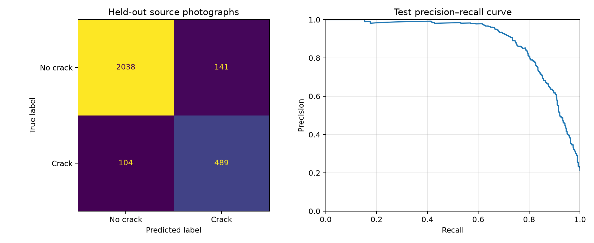

# Measured crack-classification results

This experiment uses dry SDNET2018 concrete wall images. It provides a preliminary
crack classifier and an approximate candidate-region display for the dam inspection project.

- Checkpoint: `C:\Users\Gursimran Singh\Desktop\Uzma\Concrete Project\models\best.pt`
- Checkpoint SHA-256: `99aacc0c6fcfbdcdfffa7831f312cde88b4bdbf3d2a283ac797403e036cf1602`
- Completed training epochs: 20
- GPU: NVIDIA GeForce RTX 4070 Laptop GPU
- Usable images: 18136; source photographs: 72.
- Duplicate copies removed: 1; ambiguous unique images excluded: 1.
- Split by inferred original photograph; no source group or exact hash crosses splits.
- Selected threshold: **0.217380**, maximizing validation F2.

| Split | Threshold | Accuracy | Crack precision | Crack recall | F1 | F2 |
|---|---:|---:|---:|---:|---:|---:|
| val | 0.500000 | 93.97% | 92.86% | 77.51% | 0.8449 | 0.8016 |
| val | 0.217380 | 92.13% | 79.90% | 83.99% | 0.8189 | 0.8314 |
| test | 0.500000 | 92.60% | 90.08% | 73.52% | 0.8097 | 0.7633 |
| test | 0.217380 | 91.16% | 77.62% | 82.46% | 0.7997 | 0.8145 |

Test confusion matrix at the selected threshold:

| Actual / Predicted | No crack | Crack |
|---|---:|---:|
| No crack | 2038 | 141 |
| Crack | 104 | 489 |

The held-out test has 2772 patches from 11 source photographs.
An always-no-crack baseline would have 78.61% accuracy and zero crack recall.
Test average precision: 0.8901; ROC AUC: 0.9444.
Measured batch inference throughput: 9.330 ms per patch, excluding decode and warmup.

## Interpretation

The test set was not used to tune the model or threshold. Photograph grouping reduces patch leakage,
but the wall photographs come from the same dataset and do not validate new dams or underwater conditions.
Crack scores are not independently calibrated probabilities. Sliding-window boxes have no localization
ground truth in this dataset and cannot be scored as precise crack detections or used as a crack count.

The image and video commands implement inspection software; a physical camera, freshwater specimens,
lighting, distance, turbidity and motion still need experimental validation.

Full measurements and individual predictions are in `models/metrics.json`,
`models/val_predictions.csv` and `models/test_predictions.csv`. See `README.md` for commands.
